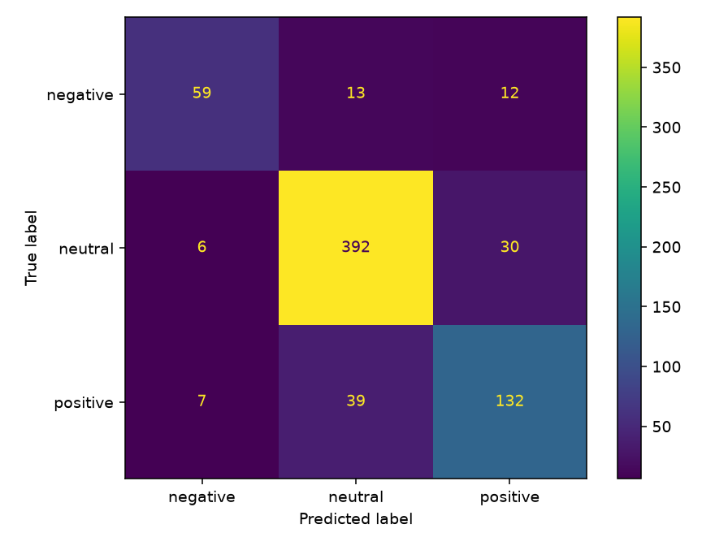

# FinSignal

A small NLP project that classifies English financial news sentences as
**positive**, **negative**, or **neutral** using TF-IDF and Logistic Regression.
Built to practice text preprocessing, model training and evaluation.

The Streamlit demo lets you enter a sentence or choose one of four examples,
then view the predicted sentiment and estimated class probabilities.

## Getting started

Tested on Windows with Python 3.14. Open a terminal in the folder containing
`app.py` and run:

```powershell
python setup_demo.py
python run_demo.py
```

Open [http://127.0.0.1:8501](http://127.0.0.1:8501). Keep the terminal running
while using the demo; press Ctrl+C to stop it. Setup is only needed once.
A trained model is included, so you can try the demo without retraining.

## Training

```powershell
.\.venv\Scripts\python.exe train.py
```

The script reads the dataset, normalizes whitespace, removes duplicate sentences
and conflicting-label groups, then creates a stratified 80/20 train/test split
with seed 42. TF-IDF is fitted only on the training data.

The model uses word unigrams and Logistic Regression with balanced class weights.
It is compared with a baseline that always predicts the most common training label.
Training overwrites the model and result files in `outputs/`.

## Data and results

This project uses the 75%-agreement subset of
[Financial PhraseBank](https://huggingface.co/datasets/takala/financial_phrasebank).
Of 3,453 original sentences, 3,448 remain after removing five duplicates.
There are 2,758 training sentences and 690 test sentences.

| Test metric | Result |
|---|---:|
| Macro-F1 | 0.8018 |
| Accuracy | 84.49% |
| Majority baseline Macro-F1 | 0.2552 |

Macro-F1 is the main metric because the neutral class is more common than the
other classes. Exact results are in `outputs/metrics.json`; predictions and
mistakes are in `outputs/test_predictions.csv` and `outputs/errors.csv`.



The model settings are fixed rather than tuned on the test set. Further tuning
would require validation data or a new independent test set.

## Project files

- `train.py` — data preparation, training and evaluation.
- `app.py` — sentence input, examples and sentiment results.
- `run_demo.py` / `setup_demo.py` — launch and dependency setup.
- `data/raw/` — dataset subset and its original license.
- `outputs/` — trained model, metrics, predictions and confusion matrix.

## Limitations

Evaluation uses a random split from the same data source; similar sentence
patterns may occur in both partitions. Performance on current news, other
markets and Vietnamese has not been tested. Numerical comparisons and mixed
sentiment can be difficult for this model. Its probabilities are uncalibrated,
and sentence sentiment does not establish stock-price predictability.

## Attribution

Financial PhraseBank is by Pekka Malo, Ankur Sinha, Pekka Korhonen, Jyrki Wallenius
and Pyry Takala. See their paper,
[Good Debt or Bad Debt: Detecting Semantic Orientations in Economic Texts](https://arxiv.org/abs/1307.5336).

Source code is MIT licensed. The dataset and data-derived artifacts retain
CC BY-NC-SA 3.0 conditions. See `THIRD_PARTY_NOTICES.md` and `data/raw/License.txt`.
